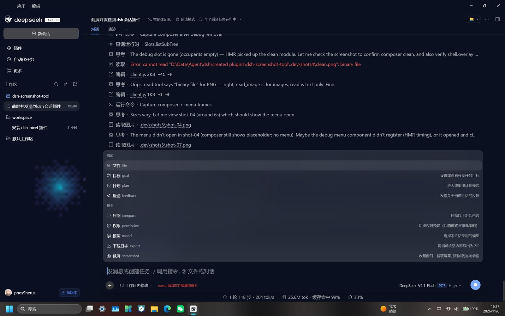
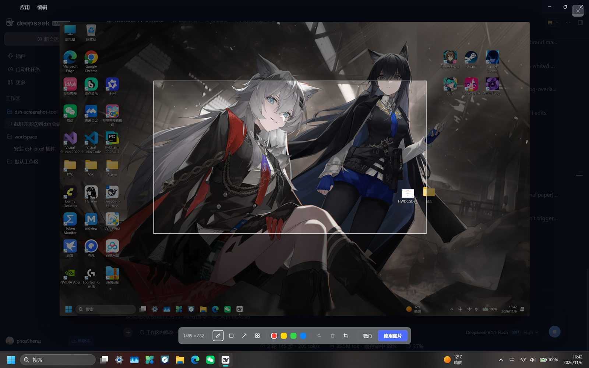

# dsh-screenshot-tool

[](LICENSE)
[](#已知限制--limitations)

给 DSH（DeepSeek Harness）桌面版用的截屏插件：在输入框工具行的 **＋** 菜单里点「截屏」，DSH 窗口会自动收起并截取整个桌面（所有显示器），拖动框选范围后可以画笔 / 矩形 / 箭头 / 马赛克标注，最后点「使用图片」把结果放进当前会话的输入框附件里。

A DSH desktop bundle that captures the screen from the composer **＋** menu, lets you crop and annotate the shot, and attaches the PNG to the current Session draft.

## 预览 / Preview

| ＋ 菜单里的「截屏」 | 框选 + 标注界面 |
|---|---|
|  |  |

## 安装 / Install

前置条件：DSH 桌面版（Electron），Windows 10/11。

1. 克隆本仓库：

   ```powershell
   git clone https://github.com/phos9herus/dsh-screenshot-tool.git
   ```

2. 把克隆下来的目录作为本地 bundle 安装：
   - 打开 DSH 的 **设置 → 插件**，选择安装本地 bundle 并指向该目录；或
   - 让 DSH 的 Agent 调用 `plugin_manager` 的 `install_bundle`，`target` 传该目录的绝对路径。

3. 安装会立即生效（Client 端热更新）。如果之后更新了 Host 半边（`index.js`），重启一次 DSH 以加载新的 Host 模块。

## 使用 / Usage

1. 在输入框下方的工具行点 **＋**（和输入 `/` 打开的是同一个菜单）。
2. 在「指令」分组里点 **截屏**。
3. DSH 窗口自动最小化约 1 秒，随后恢复并弹出截图编辑器：
   - 按住鼠标拖动框选区域；
   - 在选区内用画笔、矩形、箭头、马赛克标注，可撤销 / 清空 / 重新框选；
   - **使用图片** 把截图放进输入框（不自动发送），**取消** 或 `Esc` 放弃；`Enter` 等同「使用图片」。
4. 补上文字后正常发送即可。

> 入口位于 ＋ 菜单的「指令」分组：DSH 的「添加」分组固定为 文件 / 目标 / 计划 / 反馈，第三方插件无法加入。

## 实现 / How it works

| 文件 | 作用 |
|---|---|
| `index.js` | Host 半边：注册认证过的 `POST /api/screenshot.capture` Fetch 路由；用一段 PowerShell 脚本找到 DSH 主窗口、最小化、抓取整个虚拟桌面（DPI 感知）、恢复窗口，再回传 PNG。 |
| `client.js` | Client 半边：向 `ctx.commandUi` 注册「截屏」命令（＋ 菜单与 `/screenshot` 都可用）；在 `shell.overlay` 里渲染全屏编辑器；确认时通过 `ctx.conversation` 把 PNG 作为草稿附件加入输入框。 |
| `cordis.patch.yml` | 把插件插入当前 profile。 |
| `locale/*.json`、`icon.svg` | 插件管理页展示用的标题、描述与图标。 |

Host 侧只在 Windows 上启用；最小化失败时仍会截图，并在编辑器里提示「截图中可能包含 DSH 自身」。
截图只在点击时按需进行，不做任何常驻监听。

## 配置 / Configuration

无。插件没有 Config 字段；如需调整最小化等待时间，改 `index.js` 里的 `MINIMIZE_SETTLE_MS`。

## 已知限制 / Limitations

- 仅 Windows（使用 Win32 窗口控制 + System.Drawing 抓屏）。
- 抓屏包含任务栏与桌面图标；截图时 DSH 窗口会被收起，所以不会出现在图里。
- 标注工具为自由画笔、矩形、箭头、马赛克，不含文字输入。
- 截图流程依赖 DSH 桌面版的认证 Fetch 路由（`ctx.connection.fetch`），纯浏览器版 DSH 不适用。

## License / 许可

[MIT](LICENSE) © 2026 phos9herus
